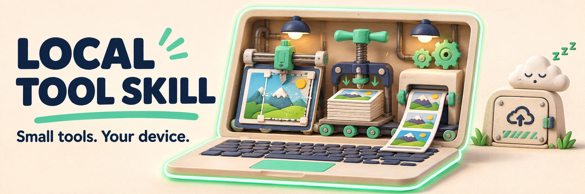

# local-tool-skill



<sub>AI で生成したコンセプト画像です。製品画面ではありません。実際の手順・実例は下記をご覧ください。</sub>

[English](README.md) · [简体中文](README.zh-CN.md) · [繁體中文（台灣）](README.zh-TW.md) · [日本語](README.ja.md) · [한국어](README.ko.md)

アカウント管理ではなく、一つの作業を解決するブラウザーツールを作るために。**local-tool** は証明写真の加工、画像圧縮、印刷レイアウトなど、端末内処理を目指す Agent Skill と TypeScript テンプレートです。

## 実例から始める

[証明写真の実装例](examples/id-photo.md) · [公開ツール](https://tools.bubufu.com/en/id-photo) · [Skill 本文](skills/local-tool/SKILL.md)

実例は参考実装であり、生成されたすべてのアプリの品質を保証するものではありません。このリポジトリは手順と補助コードを提供し、ファイル処理サーバーは提供しません。

## Skill 全体をコピー

`SKILL.md` と `templates/` を含む `skills/local-tool/` 全体を配置します。

| Agent | 配置先 |
| --- | --- |
| Claude Code | `~/.claude/skills/local-tool/` |
| Cursor | プロジェクトの `.cursor/skills/local-tool/` |
| Codex | プロジェクトの `.agents/skills/local-tool/` |

依頼例：

> local-tool skill に従って証明写真のサイズ変更ツールを作成してください。端末内で処理し、アップロードとテレメトリーは使わず、プレビュー、出力条件、プライバシー説明を付けてください。

## 再利用できる部品

| モジュール | 用途 |
| --- | --- |
| `spec.ts` | 寸法・容量条件の整理。不明な公式要件は推測しない |
| `image-io.ts` | 画像のデコードと向きの処理 |
| `compress-to-kb.ts` | 目標容量に合う JPEG 品質の探索 |
| `print-sheet.ts` | 写真の印刷用レイアウト |
| `vision.ts` | 任意の顔検出・セグメンテーション連携 |

コードは [templates](skills/local-tool/templates/) にあります。視覚モデルは別途用意する必要があり、モデルバイナリは同梱されていません。

## 公開前の確認

Node.js 20 以降：

```bash
npm ci
npm test
npm run typecheck
```

生成アプリでは通信、モバイル表示、出力寸法、公式写真規格も確認してください。「端末内処理・テレメトリーなし」は設計要件であり、任意の生成コードの監査証明ではありません。任意のモデルは自前で配信し、外部への実行時ダウンロードを無断で追加しないでください。開発期間や全用途への適合は保証しません。

Skill が現在要求する UI 言語は英語と簡体字中国語です。README の五言語化は生成アプリの五言語対応を意味しません。

## 利用と貢献

商用利用・改変が可能です。著作権表示とライセンス文を残してください。
（[MIT](LICENSE)）

再現可能な不具合やテスト済みの手順を歓迎します。[従来の詳細説明](README.reference.md) · [機械可読の概要](llms.txt)
