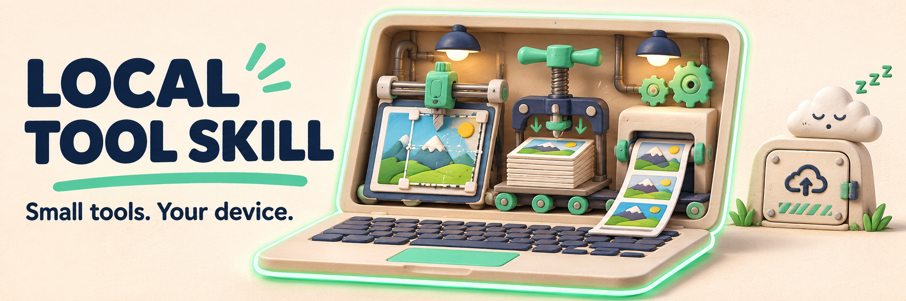

# local-tool-skill



<sub>AI로 만든 콘셉트 이미지이며 제품 스크린샷이 아닙니다. 실제 사용 방법과 예제는 아래에서 확인하세요.</sub>

[English](README.md) · [简体中文](README.zh-CN.md) · [繁體中文（台灣）](README.zh-TW.md) · [日本語](README.ja.md) · [한국어](README.ko.md)

계정 시스템 대신 한 가지 작업을 해결하는 브라우저 도구를 만드세요. **local-tool**은 증명사진 편집, 이미지 압축, 인쇄 배치처럼 기기 내 처리를 지향하는 Agent Skill과 TypeScript 템플릿입니다.

## 실제 사용 사례

[증명사진 구현 예제](examples/id-photo.md) · [공개 도구](https://tools.bubufu.com/en/id-photo) · [Skill 설명](skills/local-tool/SKILL.md)

예제는 참고 구현이며 모든 생성 결과의 배포 품질을 보장하지 않습니다. 이 저장소는 지침과 보조 코드를 제공하며 파일 처리 서버를 제공하지 않습니다.

## Skill 전체 설치

`SKILL.md`와 `templates/`를 포함한 `skills/local-tool/` 전체를 복사하세요.

| Agent | 설치 위치 |
| --- | --- |
| Claude Code | `~/.claude/skills/local-tool/` |
| Cursor | 프로젝트의 `.cursor/skills/local-tool/` |
| Codex | 프로젝트의 `.agents/skills/local-tool/` |

요청 예시:

> local-tool skill에 따라 증명사진 크기 조정 도구를 만들어 주세요. 기기 안에서 처리하고 업로드와 텔레메트리를 사용하지 마세요. 미리보기, 명확한 내보내기 조건과 개인정보 안내를 포함하세요.

## 재사용할 구성 요소

| 모듈 | 용도 |
| --- | --- |
| `spec.ts` | 크기·용량 조건 정리. 불명확한 공식 규격은 추측하지 않기 |
| `image-io.ts` | 이미지 디코딩과 방향 처리 |
| `compress-to-kb.ts` | 목표 용량에 맞는 JPEG 품질 탐색 |
| `print-sheet.ts` | 사진 인쇄 배치 |
| `vision.ts` | 선택적인 얼굴 감지 및 분할 연동 |

코드는 [templates](skills/local-tool/templates/)에 있습니다. 비전 모델은 별도로 준비해야 하며 모델 바이너리는 포함하지 않습니다.

## 배포 전 검증

Node.js 20 이상:

```bash
npm ci
npm test
npm run typecheck
```

생성 앱은 네트워크 요청, 모바일 화면, 내보내기 크기와 공식 사진 규격도 확인해야 합니다. ‘기기 내 처리·텔레메트리 없음’은 설계 요구사항이지 임의의 생성 코드에 대한 감사 인증이 아닙니다. 선택적 모델은 직접 호스팅하고 외부 런타임 다운로드를 몰래 추가하지 마세요. 개발 기간이나 모든 용도의 규정 준수를 보장하지 않습니다.

Skill이 현재 요구하는 UI는 영어와 중국어 간체입니다. 다섯 언어 README가 생성 앱의 다섯 언어 지원을 뜻하지는 않습니다.

## 사용과 기여

상업적 사용 및 수정이 가능합니다. 저작권과 라이선스 고지를 유지하세요.
([MIT](LICENSE))

재현 가능한 오류와 테스트된 워크플로 기여를 환영합니다. [기존 상세 문서](README.reference.md) · [기계 판독용 요약](llms.txt)
