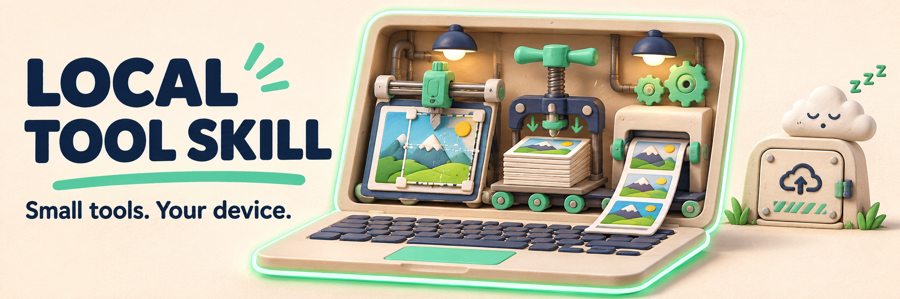

# local-tool-skill



<sub>AI-generated concept cover, not a product screenshot. See the real workflow/examples below.</sub>

[English](README.md) · [简体中文](README.zh-CN.md) · [繁體中文（台灣）](README.zh-TW.md) · [日本語](README.ja.md) · [한국어](README.ko.md)

Build one useful browser tool, not another account system. **local-tool** is an agent skill and TypeScript starter kit for on-device workflows such as ID-photo resizing, file-size compression and print-sheet export.

## Start with a real workflow

[ID-photo walkthrough](examples/id-photo.md) · [Published ID-photo tool](https://tools.bubufu.com/en/id-photo) · [Skill instructions](skills/local-tool/SKILL.md)

The walkthrough is a reference implementation, not a promise that every generated tool is already production-ready. This repository ships instructions and helpers, not a hosted processing service.

## Install the complete skill

Copy `skills/local-tool/`, including `SKILL.md` and `templates/`, into your agent's skill directory:

| Agent | Destination |
| --- | --- |
| Claude Code | `~/.claude/skills/local-tool/` |
| Cursor | `.cursor/skills/local-tool/` in the project |
| Codex | `.agents/skills/local-tool/` in the project |

Then ask:

> Build a local tool for resizing an ID photo. Follow the local-tool skill. Process files on-device, with no uploads or telemetry. Include a preview, explicit export constraints and a clear privacy explanation.

## What you reuse

| Module | Useful when you need to… |
| --- | --- |
| `spec.ts` | Normalize dimension and file-size requirements without inventing missing official rules |
| `image-io.ts` | Decode images and handle orientation |
| `compress-to-kb.ts` | Search for a JPEG quality that meets a target size |
| `print-sheet.ts` | Lay out photos on a printable sheet |
| `vision.ts` | Connect optional face detection and segmentation |

All modules live in [templates](skills/local-tool/templates/). Optional vision models must be provisioned separately; the template does not include model binaries.

## Verify before shipping

Node.js 20 or later:

```bash
npm ci
npm test
npm run typecheck
```

For the generated app, also inspect browser network traffic, test mobile layouts and export dimensions, and check official photo specifications. “On-device / no telemetry” is the intended design contract, not an audit certificate for arbitrary generated code. Host optional models locally; do not silently introduce third-party runtime downloads. There is no guaranteed delivery time or universal compliance guarantee.

The skill currently requires English and Simplified Chinese UI; these five README translations do not imply five-language support in generated apps.

## Use and contribute

Commercial use and modification are allowed; retain the copyright and license notice.
([MIT](LICENSE))

Report a reproducible template bug or contribute a tested workflow. [Previous detailed guide](README.reference.md) · [Machine-readable project summary](llms.txt)
