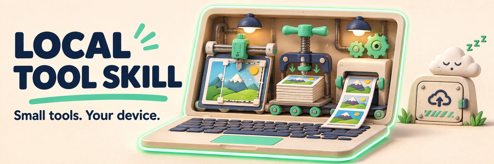

# local-tool-skill



<sub>AI 產生的概念主視覺，不是產品截圖；實際流程與範例請見下方。</sub>

[English](README.md) · [简体中文](README.zh-CN.md) · [繁體中文（台灣）](README.zh-TW.md) · [日本語](README.ja.md) · [한국어](README.ko.md)

做一個真正實用的瀏覽器小工具，而不是再做一套帳號系統。**local-tool** 是供 Agent 使用的 Skill 與 TypeScript 範本，適合證件照裁切、圖片壓縮、列印排版等裝置端處理流程。

## 從實際用途開始

[證件照完整範例](examples/id-photo.md) · [已發布的證件照工具](https://tools.bubufu.com/en/id-photo) · [Skill 說明](skills/local-tool/SKILL.md)

範例是實作參考，不代表所有產生結果都已達正式上線標準。儲存庫提供指引與輔助模組，不是代管檔案處理服務。

## 安裝完整 Skill

複製整個 `skills/local-tool/`，保留 `SKILL.md` 和 `templates/`：

| Agent | 放置位置 |
| --- | --- |
| Claude Code | `~/.claude/skills/local-tool/` |
| Cursor | 專案的 `.cursor/skills/local-tool/` |
| Codex | 專案的 `.agents/skills/local-tool/` |

可以這樣提出需求：

> 依 local-tool skill 製作證件照尺寸調整工具。檔案只在本機處理，不上傳、不加入遙測。提供預覽、明確的匯出限制與隱私說明。

## 可以直接重用什麼

| 模組 | 解決的問題 |
| --- | --- |
| `spec.ts` | 整理尺寸與檔案大小要求，不捏造缺漏的官方規範 |
| `image-io.ts` | 圖片解碼與方向處理 |
| `compress-to-kb.ts` | 尋找符合目標大小的 JPEG 品質 |
| `print-sheet.ts` | 多張照片的列印排版 |
| `vision.ts` | 選用的臉部偵測與分割整合 |

程式碼在 [templates](skills/local-tool/templates/)。視覺模型須另外設定，範本不附模型二進位檔。

## 上線前驗證

需要 Node.js 20 以上：

```bash
npm ci
npm test
npm run typecheck
```

產生的應用程式還須檢查網路請求、手機版面、匯出尺寸與官方證件照規範。「裝置端處理、無遙測」是設計要求，不是任意產生程式碼的稽核保證。選用模型應自行代管，不要默默加入第三方執行期下載；不保證開發時間或所有情境都符合法規。

Skill 目前要求英文與簡中介面；五語 README 不代表產生的應用程式自動支援五種語言。

## 使用與貢獻

可商用及修改，請保留著作權與授權聲明。
（[MIT](LICENSE)）

歡迎提交可重現的問題與通過測試的流程。[原詳細說明](README.reference.md) · [機器可讀摘要](llms.txt)
